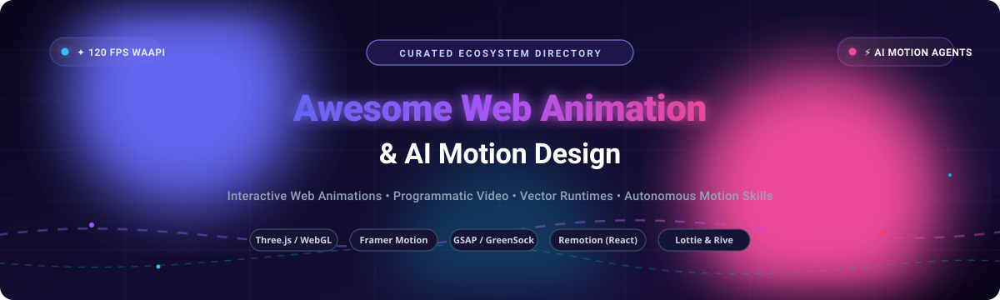

# 🎨 Awesome Web Animation & AI Motion Design 🚀

  

  
  
  
  
  
  

---

## 🌟 Overview &amp; Ecosystem Scope

A comprehensive, SEO-optimized curated directory tracking world-class **SaaS / Hosted Platforms** and high-performance **Open-Source GitHub Projects** driving **Web Animation, Programmatic Motion Graphics, Vector Runtimes, and AI Motion Design Skills**. 

Modern digital design demands hardware-accelerated 60/120 FPS web animations, smooth scroll-driven choreography, real-time vector state machines, and generative AI agent workflows that automate award-winning motion aesthetics. This directory serves creative technologists, UI/UX motion designers, frontend developers, and AI engineers architecting next-generation interactive web experiences.

---

## 📑 Table of Contents
- [📊 Sector Overview &amp; Market Dynamics](#-sector-overview--market-dynamics)
- [🏢 SaaS &amp; Hosted Motion Platforms](#-saas--hosted-motion-platforms)
- [💻 Open-Source GitHub Projects](#-open-source-github-projects)
- [📈 Star History](#-star-history)
- [💖 Support &amp; Sponsorship](#-support--sponsorship)
- [🤝 How to Contribute](#-how-to-contribute)
- [📄 License](#-license)

---

## 📊 Sector Overview &amp; Market Dynamics

The global animation, digital motion design, and interactive web visual software market is valued at approximately **$412 Billion** in 2026, projected to exceed **$630 Billion by 2032** at an 8.2% CAGR. The industry exhibits a **moderately fragmented** ecosystem: while creative enterprise tooling is historically anchored by multi-billion dollar incumbents (such as Adobe), rapid modern web shifts toward vector WebAssembly runtimes (Rive, dotLottie), real-time WebGL/3D scene editors (Spline, Unicorn Studio), and autonomous AI-assisted motion coding agents have catalyzed specialized category champions with high market velocity.

---

## 🏢 SaaS &amp; Hosted Motion Platforms

The table below lists leading SaaS and hosted animation products sorted in descending order by **Company Size / Estimated Valuation &amp; Revenue**, with verified starting tier pricing and specific free tier / trial allowances.

| Product / Platform 🏷️ | Valuation / Company Size 📈 | Starting Pricing 💳 | Free Tier / Trial Limits 🎁 | Description 📝 |
| :--- | :--- | :--- | :--- | :--- |
| **[Adobe Animate CC](https://adobe.com)** | **$214 Billion Market Cap** (Public: NASDAQ: ADBE; ~$21.4B Annual Revenue) | **$22.99 / month** (Annual plan, paid monthly) | **7-day free trial** with full access to complete desktop tooling, creative cloud storage, and export options | Enterprise-standard vector animation, puppet rigging, and rich interactive multimedia suite exporting to HTML5 Canvas, WebGL, SVG, and video formats. |
| **[Animaker](https://animaker.com)** | **~$150M - $200M Valuation** (Estimated ~$35M ARR, 20M+ registered users) | **$15 / month** (Basic plan, billed annually at $180/yr) | **Free forever plan** with 5 video downloads/month with watermark, 720p HD quality, and access to basic asset library | Cloud-based DIY animation and explainer video creator featuring drag-and-drop character rigging, auto lip-sync, and automated text-to-speech timelines. |
| **[LottieFiles](https://lottiefiles.com)** | **~$120M Valuation** ($37M+ total venture funding led by Square Peg &amp; M12) | **$19.99 / seat / month** (Pro plan, billed annually) | **Free forever plan** with 1 team workspace, up to 10 private animations, unlimited public animations, and access to free community Lottie library | Cloud collaboration hub, marketplace, and visual player suite for testing, hosting, and optimizing lightweight dotLottie &amp; JSON animations across web, iOS, and Android. |
| **[Spline](https://spline.design)** | **~$100M Valuation** ($15M Series A led by OpenAI Startup Fund, Index Ventures) | **$9 / month** (Super plan, billed annually) | **Free forever plan** with unlimited personal files, 3D scene editing, public scene embeds, basic material library, and community file access | Collaborative browser-based 3D design and interactive motion software exporting real-time WebGL scenes, physics interactions, and production React components. |
| **[Rive](https://rive.app)** | **~$80M Valuation** ($14M+ total funding led by Two Sigma Ventures &amp; Andreessen Horowitz) | **$14 / seat / month** (Starter plan, billed annually) | **Free forever plan** with unlimited public files, 3 private files, single-editor access, and complete interactive state machine capabilities | Real-time interactive animation platform featuring visual state machines that react dynamically to cursor movements, scroll triggers, and runtime logic on the web. |
| **[Jitter](https://jitter.video)** | **~$35M - $50M Valuation** ($3M+ seed led by Headline, 1M+ active users) | **$12 / month** (Pro plan, billed annually) | **Free forever plan** with unlimited project creation, 720p/30fps MP4 and WebM video exports with small Jitter watermark, and standard animation presets | Ultra-fast browser-based motion design platform enabling teams to animate UI prototypes, Figma vectors, and social media videos with Lottie, WebM, and GIF export. |
| **[Moovly](https://moovly.com)** | **~$18M Market Cap** (Public: TSXV: MVY; ~$2.5M Annual Revenue) | **$33.25 / month** (Pro plan, billed annually at $399/yr) | **Free forever plan** with 20 personal video projects, 480p SD quality watermarked exports, and access to 1 million royalty-free stock assets | Enterprise multimedia video editor combining rich presentation templates, stock assets, AI script writing, and automated text-to-video animation pipelines. |
| **[Unicorn Studio](https://unicorn.studio)** | **~$10M - $15M Valuation** (Self-funded / Bootstrapped, ~$1.5M ARR) | **$14 / month** (Pro Maker tier, billed annually) | **Free forever plan** with 1 live embed project, 5,000 monthly embed views, standard shader effects, and watermarked WebGL canvas player | Visual WebGL and GLSL shader animation design tool for building interactive, GPU-accelerated hero canvas backgrounds, fluid physics, and holographic web effects. |
| **[Hera / Phase](https://phase.com)** | **~$8M - $12M Valuation** ($3.2M seed funding led by early-stage tech funds) | **$15 / seat / month** (Pro plan, billed annually) | **Free forever plan** with 3 active projects, full timeline keyframing, web animation canvas, and CSS/SVG code inspection tools | Collaborative UI motion design and interactive prototyping software bridging visual keyframe curves with production-grade digital animation code. |
| **[MotionSites Unlimited](https://motionsites.ai)** | **~$2M - $5M Valuation** (Early-stage venture / AI product studio, ~$400k ARR) | **$29 / month** (Creator Pro access) | **14-day free trial** with access to 5 AI motion design prompts, Claude skill MCP integration, and starter WebGL template library | Curated AI motion design prompt library, MCP server, and Claude agent toolkit supplying cinematic hero animation code blueprints and web-building workflows. |

---

## 💻 Open-Source GitHub Projects

Explore the top open-source web animation engines, layout transition frameworks, 3D WebGL runtimes, and AI motion design skills. Ranked in descending order by **GitHub Star Count**, each repo features an official social star badge directly linking to its stargazers page.

1. **[mrdoob/three.js](https://github.com/mrdoob/three.js)**   
   *JavaScript 3D library powering WebGL, WebGPU, realistic physics, interactive shaders, and spatial 3D web motion.*

2. **[animate-css/animate.css](https://github.com/animate-css/animate.css)**   
   *Cross-browser library of ready-to-use CSS animations for landing pages, bounce effects, entrance reveals, and micro-interactions.*

3. **[juliangarnier/anime](https://github.com/juliangarnier/anime)**   
   *Ultra-fast, versatile JavaScript animation engine animating CSS properties, SVG paths, DOM attributes, and raw JavaScript objects.*

4. **[remotion-dev/remotion](https://github.com/remotion-dev/remotion)**   
   *Flagship open-source framework for building programmatic motion graphics, interactive canvases, and MP4/WebM videos using React and TypeScript.*

5. **[pixijs/pixijs](https://github.com/pixijs/pixijs)**   
   *Super-fast 2D WebGL/WebGPU rendering engine designed for creating rich interactive graphics, animated canvas sprites, and high-FPS web experiences.*

6. **[motiondivision/motion](https://github.com/motiondivision/motion)**   
   *Production-ready motion library for JavaScript and React (formerly Framer Motion), uniting declarative springs, drag gestures, and the Web Animations API.*

7. **[pmndrs/react-three-fiber](https://github.com/pmndrs/react-three-fiber)**   
   *Declarative React renderer for Three.js, enabling composable 3D web scenes, post-processing motion pipelines, and physics-driven interactive UI.*

8. **[airbnb/lottie-web](https://github.com/airbnb/lottie-web)**   
   *Airbnb's official library for rendering Adobe After Effects Bodymovin vector animations natively on web pages via SVG, HTML, and Canvas.*

9. **[greensock/GSAP](https://github.com/greensock/GSAP)**   
   *The gold standard in high-performance JavaScript animation, offering timeline choreography and plugins (ScrollTrigger, SplitText, MorphSVG, Flip).*

10. **[pmndrs/react-spring](https://github.com/pmndrs/react-spring)**   
    *Spring-physics driven animation library for modern React web applications, creating fluid, organic gesture-driven UI movement.*

11. **[michalsnik/aos](https://github.com/michalsnik/aos)**   
    *Animate On Scroll (AOS) library for triggering buttery CSS3 animations as elements enter the viewport.*

12. **[magicuidesign/magicui](https://github.com/magicuidesign/magicui)**   
    *Curated open-source collection of animated React, Tailwind CSS, and Framer Motion components designed for viral landing pages.*

13. **[chenglou/react-motion](https://github.com/chenglou/react-motion)**   
    *Pioneering spring physics library for React resolving transition interrupts and realistic kinematic damping without hardcoded durations.*

14. **[Popmotion/popmotion](https://github.com/Popmotion/popmotion)**   
    *Low-level 11kB functional JavaScript animation toolkit powering keyframes, springs, inertia decay, and tweening.*

15. **[motion-canvas/motion-canvas](https://github.com/motion-canvas/motion-canvas)**   
    *TypeScript library and visual real-time editor for authoring programmatic vector animations and video presentations with code.*

16. **[darkroomengineering/lenis](https://github.com/darkroomengineering/lenis)**   
    *Sensational lightweight smooth scroll library engineered by Darkroom Engineering to synchronize silky scrolling with GSAP ScrollTrigger and WebGL.*

17. **[julianshapiro/velocity](https://github.com/julianshapiro/velocity)**   
    *Accelerated JavaScript animation engine executing color animation, transforms, loops, and sequences with high performance.*

18. **[formkit/auto-animate](https://github.com/formkit/auto-animate)**   
    *Zero-config, drop-in animation utility that seamlessly animates DOM element additions, deletions, and moves with a single line of code.*

19. **[theatre-js/theatre](https://github.com/theatre-js/theatre)**   
    *Visual motion design studio and animation library for choreographing Three.js, React Three Fiber, HTML/SVG, and dynamic variables in code.*

20. **[barbajs/barba](https://github.com/barbajs/barba)**   
    *Extensible, modular JavaScript library for creating seamless, app-like page transitions and preloading for multi-page websites.*

21. **[pmndrs/drei](https://github.com/pmndrs/drei)**   
    *Growing collection of useful helpers, camera controls, shaders, and animation utilities for React Three Fiber.*

22. **[tweenjs/tween.js](https://github.com/tweenjs/tween.js)**   
    *Simple, fast, and flexible JavaScript tweening engine widely utilized for smooth numeric and coordinate interpolation in WebGL/HTML5.*

23. **[opentoonz/opentoonz](https://github.com/opentoonz/opentoonz)**   
    *Production-grade open-source 2D animation software used by Studio Ghibli, featuring vector drawing, skeletal rigging, and FX nodes.*

24. **[ibelick/motion-primitives](https://github.com/ibelick/motion-primitives)**   
    *Beautiful, interactive UI motion components crafted with Motion (Framer Motion) and Tailwind CSS for rapid web prototyping.*

25. **[swup/swup](https://github.com/swup/swup)**   
    *Versatile page transition library that enhances multi-page sites with fluid CSS/JS transitions without requiring complex single-page apps.*

26. **[electerious/basicScroll](https://github.com/electerious/basicScroll)**   
    *Mobile-friendly parallax and scroll-driven animation library leveraging CSS custom variables for direct hardware acceleration.*

27. **[thednp/kute.js](https://github.com/thednp/kute.js)**   
    *Modern JavaScript animation engine specialized in SVG morphing, CSS3 properties, drawing paths, and custom attributes.*

28. **[Motionsites-AI/claude-skill](https://github.com/Motionsites-AI/claude-skill)**   
    *Open-source Claude Code and Claude Desktop skill empowering autonomous AI coding agents to plan, design, and iteratively refine cinematic motion websites.*

29. **[cth9191/animate](https://github.com/cth9191/animate)**   
    *Open-source Claude Code plugin for generating beat-mapped procedural canvas animations, storyboard choreography, and motion graphics.*

30. **[friction2d/friction](https://github.com/friction2d/friction)**   
    *Open-source 2D motion graphics and vector animation studio featuring node-based compositing, curve editors, and video/SVG export.*

31. **[martinlaxenaire/curtainsjs](https://github.com/martinlaxenaire/curtainsjs)**   
    *Lightweight WebGL engine transforming HTML DOM media elements into interactive 3D textured planes with custom GLSL shaders.*

32. **[rive-app/rive-wasm](https://github.com/rive-app/rive-wasm)**   
    *Official WebAssembly runtime for Rive, executing real-time vector animations and interactive state machines at native speeds in browsers.*

33. **[LottieFiles/dotlottie-web](https://github.com/LottieFiles/dotlottie-web)**   
    *Next-generation open-source WebAssembly player for `.lottie` files with state machines, multi-animation bundles, and reduced memory footprints.*

34. **[charlie947/motion-graphics-skills](https://github.com/charlie947/motion-graphics-skills)**   
    *Suite of 15 specialized Claude Code skills generating launch-ready code-driven motion graphics, animated infographics, and video reels.*

---

##  Star History

---

##  Support & Sponsorship

Thank you so much for exploring and using **Awesome Web Animation & AI Motion Design**! 💫

If this curated repository has inspired your creative workflow, helped your development projects, or introduced you to new motion design tools, please consider supporting the project:

- 🌟 **Star the repository** to boost discoverability on GitHub!
- 🍴 **Fork the project** and contribute your favorite web animation tools or AI motion skills.
- 📣 **Share with your team**, creative engineering peers, and developer communities.
- ☕ **Buy a coffee or become a sponsor**: Support ongoing open-source maintenance via the [GitHub Sponsors Dashboard](https://github.com/sponsors/ishandutta2007)!

Your support is deeply appreciated and keeps the open-source creative ecosystem thriving! 🚀

---

## 🤝 How to Contribute

We welcome additions, fixes, and ecosystem updates! Please follow these contribution guidelines:

1. **Verify Relevance**: Entries must directly relate to interactive web animation, programmatic motion graphics, vector runtimes, or AI motion design skills.
2. **Include Verified Details**: Provide official documentation links, factual starting tier pricing, and explicit free tier or trial constraints.
3. **Format Consistently**: Place new open-source projects into the star-sorted ranking with appropriate badges.
4. **Submit a PR**: Open a clear Pull Request with descriptive commit summaries.

---

## 📄 License

This repository is distributed under the [MIT License](LICENSE). Feel free to adapt and share with attribution.
